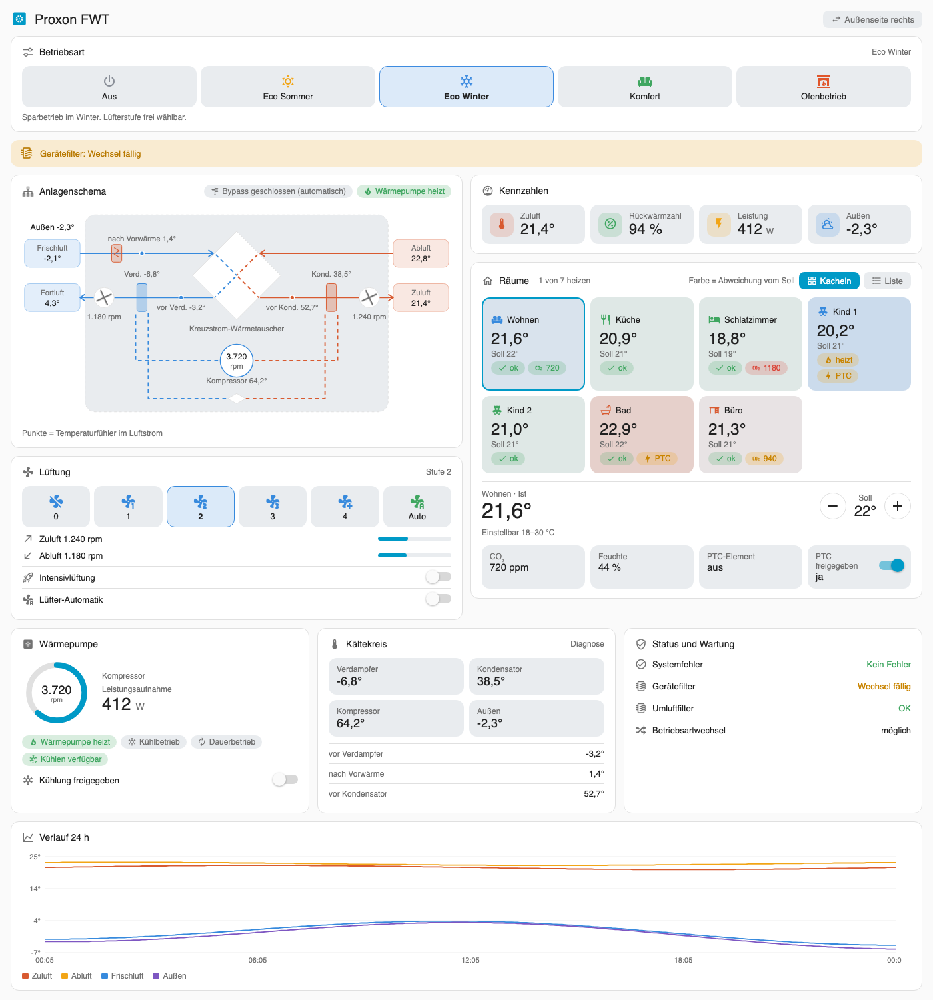
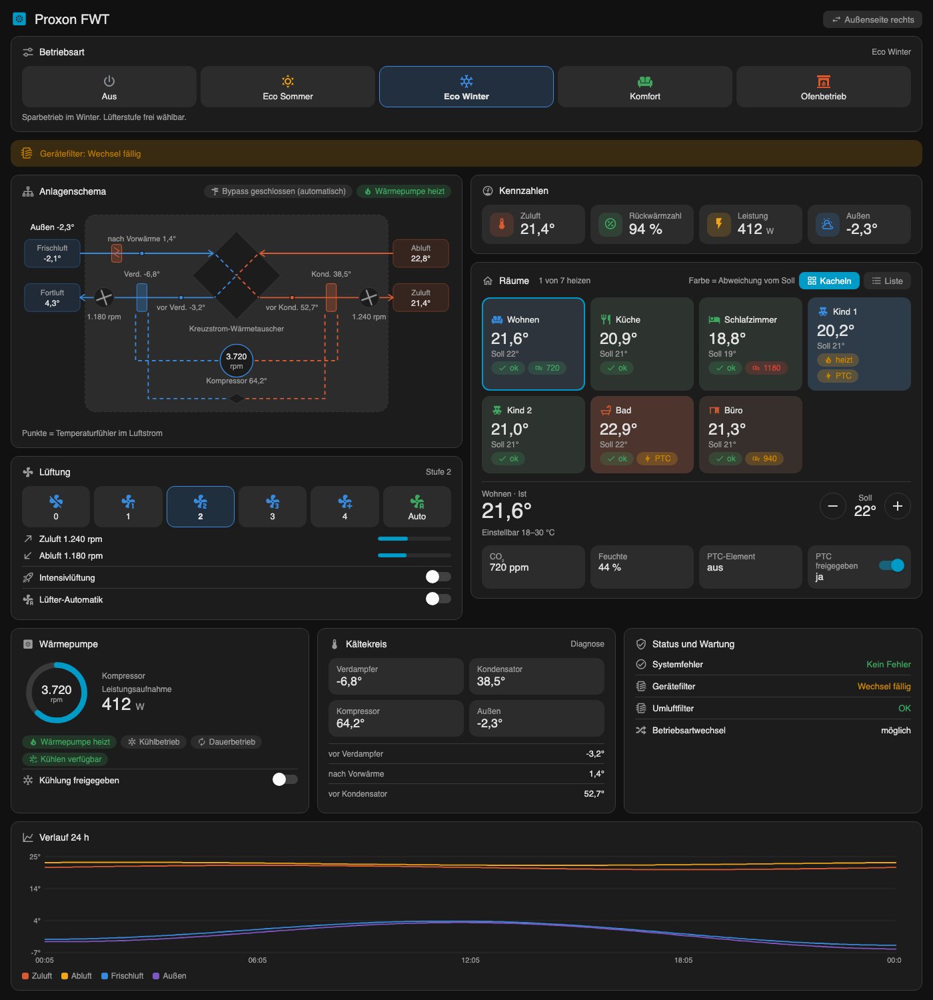

<p align="center">
  
</p>

<h1 align="center">Proxon FWT (Modbus)</h1>

<p align="center">
  Home-Assistant-Integration für die Proxon FWT Frischluftwärmetechnik – per Modbus TCP oder RTU, komplett über die Oberfläche einrichtbar.
</p>

<p align="center">
  <a href="https://github.com/hacs/integration"></a>
  <a href="https://www.home-assistant.io/"></a>
  <a href="https://github.com/bertel2020/HA-Proxon_FWT/releases"></a>
  <a href="https://github.com/bertel2020/HA-Proxon_FWT/actions/workflows/hassfest.yaml"></a>
  <a href="https://github.com/bertel2020/HA-Proxon_FWT/actions/workflows/hacs.yaml"></a>
  <a href="LICENSE"></a>
</p>

<p align="center">
  <a href="https://buymeacoffee.com/bertel2020"></a>
  <a href="https://ko-fi.com/bertel2020"></a>
  <a href="https://paypal.me/RobertoMartins"></a>
</p>

<p align="center"><em><a href="README.en.md">🇬🇧 English version</a></em></p>

Eine über die Oberfläche konfigurierbare Home-Assistant-Custom-Integration für die **Proxon FWT - Frischluftwärmetechnik**, die per Modbus mit ihrem **FWT Modbus-Gateway** kommuniziert. Sie nutzt eine vollwertige Config-Entry-Integration: einen Config-Flow, einen gemeinsam genutzten `DataUpdateCoordinator` und typisierte Entities (`climate`, `sensor`, `binary_sensor`, `switch`, `select`) — auf Basis der [modernisierten Modbus-Architektur](https://developers.home-assistant.io/blog/2026/07/05/modernizing-modbus/) von Home Assistant (Einrichtung über einen Config-Entry statt handgeschriebener YAML-Registerlisten, die Verbindung kommt als gemeinsam genutzte Unit von der `modbus`-Integration, Plattformen auf Basis von Entity-Descriptions).

Beide Übertragungsarten werden unterstützt:
- **Modbus TCP** — das Gateway über das Netzwerk erreichbar (z.B. `192.168.x.x:502`).
- **Modbus RTU** — eine direkte USB-zu-Seriell-Verbindung (RS-485), z.B. `/dev/ttyUSB0`.

## Voraussetzungen

- Home Assistant **2026.9.0** oder neuer (die Integration nutzt die `modbus`-Integration von Home Assistant für die Verbindung).

## Installation

### Über HACS (empfohlen)

[](https://my.home-assistant.io/redirect/hacs_repository/?owner=bertel2020&repository=HA-Proxon_FWT&category=integration)
[](https://my.home-assistant.io/redirect/config_flow_start/?domain=proxon_modbus)

1. Über den ersten Button das Proxon-FWT-Repository in HACS öffnen.
2. **Proxon FWT (Modbus)** herunterladen und Home Assistant neu starten.
3. Über den zweiten Button die Integration hinzufügen. Alternativ in Home
   Assistant **Einstellungen → Geräte & Dienste → Integration hinzufügen →
   Proxon FWT (Modbus)** öffnen.

Falls der erste Button nicht funktioniert, in HACS unter **Integrationen →
Benutzerdefinierte Repositories**
`https://github.com/bertel2020/HA-Proxon_FWT` als Kategorie **Integration**
eintragen.

### Manuell

Das Verzeichnis `custom_components/proxon_modbus` nach
`/config/custom_components/proxon_modbus` kopieren und Home Assistant neu
starten.

## Einrichtung

Einstellungen → Geräte & Dienste → Integration hinzufügen → **Proxon FWT (Modbus)**.

1. **Netzwerk (Modbus TCP)** oder **USB / RS-485 (Modbus RTU)** wählen.
   - TCP: Host/IP, Port (Standard `502`), Modbus-Unit-ID (Standard `10`).
   - RTU: serielle Schnittstelle, Baudrate (Standard `9600`), Datenbits (`8`), Parität (Standard `E`/Even), Stopbits (`1`), Modbus-Unit-ID.
2. Anzahl der Räume (1–16) und externen CO₂-/Feuchtesensoren (0–5) festlegen, für die Entities angelegt werden, ob am Gerät überhaupt **Kühlen verfügbar** ist (siehe unten) und auf welcher **Seite die Außenluft** liegt (Frischluft und Fortluft; das dreht das Schema in Karte und Panel).
3. **Räume benennen:** Der nächste Schritt zeigt für jeden Raum ein Namensfeld und einen optionalen **Bereich** von Home Assistant. Vorgeschlagen werden die Namen, die schon vorhanden sind (bei einer bestehenden Einrichtung die bisherigen), und ein Bereich mit passendem Namen. Ein leerer Raumname überspringt einen nicht verbauten Raum. Hier lassen sich auch CO₂-/Feuchtesensoren einem Raum zuordnen.
4. Später über den **Konfigurieren**-Button (Optionen) der Integration dasselbe Formular erneut öffnen, Anzahl, Abfrageintervall, Kühlverfügbarkeit, Außenseite, Filter-Intervall (in Tagen, Standard 180), einen optionalen Umluftfilter, die Dauer des Stoßlüftens (Standard 15 Minuten) sowie eigene Leistungs- und Außentemperatursensoren ändern, ohne die Integration neu einzurichten. Host, Port, serielle Parameter und Unit-ID lassen sich über ⋮ → **Neu konfigurieren** ändern.

## Entities

Es werden zwei Arten von Geräten angelegt: ein **zentrales Gerät** (standardmäßig "Proxon FWT") für die Funktionen der Gesamtanlage, und **ein eigenes Gerät je konfiguriertem Raum** (benannt nach dem jeweiligen Raumnamen), das mit dem zentralen Gerät verknüpft ist.

**Zentrales Gerät (Zentralfunktionen):**

- **`sensor.*`** — Zu-/Ab-/Fort-/Frischlufttemperaturen, Kältemittelkreislauf-Temperaturen, Außentemperatur, Drehzahl Kompressor, Leistungsaufnahme, Lüfterdrehzahlen, dazu ein diagnostischer "Betriebsart (vollständiger Zustand)"-Sensor sowie alle konfigurierten CO₂-/Feuchtesensoren (sofern nicht einem Raum zugeordnet, siehe unten).
- **`binary_sensor.*`** — Bypass-Zustand, **Kühlen verfügbar** (siehe unten), System-/Filtermeldungen, Wärmepumpe Heiz-/Kühl-/Dauerbetrieb, sowie (Diagnose) die übrigen "ist X gerade wählbar"-Freischaltungs-Flags aus Register 315.
- **`switch.*`** — globale Kühlfreigabe, Lüfter-Automatik, Intensivlüftung, **Stoßlüften** (mit Timer) und die optionale Lüfterstufen-Wiederherstellung.
- **`select.*`** — Lüfterstufe (Aus/1–4) und Betriebsart (Aus/Eco Sommer/Eco Winter/Komfort/Ofenbetrieb).
- **`button.*`** — **Filter getauscht**: setzt Alter und Frist des Gerätefilters zurück (siehe [Filter und Wartung](#filter-und-wartung)).

**Je Raum:**

- **`climate.<raum>`** — aktuelle Temperatur (Register `150+n`), Solltemperatur (gelesen von `180+n`, geschrieben auf das separate, nur schreibbare Register `200+n`). Der einstellbare Bereich folgt dem Gerät: Raum 1 (Wohnen) direkt 18–30 °C, alle anderen Räume ihre Mittentemperatur ±3 °C (ganze Grad, innerhalb 18–30 °C; fehlt die Mittentemperatur, gilt 18–30 °C). Die Betriebsart ist „Heizen“, und nur „Heizen/Kühlen“, wenn Kühlen am Gerät verfügbar (Freischaltung, Register 315) und freigegeben (Register 306) ist.
- **`binary_sensor.*`** — PTC-Element aktiv (aktueller **Zustand**, Register 300).
- **`switch.*`** — PTC-Element freigegeben (**Freigabe**, Register 301/302).
- **`sensor.*`** — Mittentemperatur (Raum 2–N, Rückmeldung vom Bedienteil).
- Optional auch ein oder mehrere **CO₂-/Feuchtesensoren**, wenn ihnen im Options-Flow (Namen-Schritt) dieser Raum zugewiesen wurde.

Eine vollständige Liste aller Entities mit Beschreibung steht weiter unten unter [Alle Entities im Detail](#alle-entities-im-detail).

### Kühlen verfügbar — manuelle Einstellung als Hauptschalter

Register 315 Bit 8 soll laut Dokumentation melden, ob die Anlage Kühlen überhaupt unterstützt — in der Praxis hat sich dieses Bit aber bei manchen Anlagen als nicht zuverlässig erwiesen. Deshalb gibt es dafür zusätzlich eine **manuelle Einstellung** ("Kühlen am Gerät verfügbar", Ersteinrichtung und Options-Flow, Standard: Ja), die als grober Hauptschalter wirkt:

- **Ja (Standard):** Kühl-Entities werden ganz normal angelegt, und ihre Verfügbarkeit richtet sich weiterhin **live nach dem Bit** — genau wie bei jedem anderen betriebsartabhängigen Bedienelement. Meldet die Anlage über das Bit gerade "kein Kühlen möglich", werden `switch.proxon_fwt_kuhlung_freigegeben` und `binary_sensor.proxon_fwt_warmepumpe_kuhlbetrieb` entsprechend nicht verfügbar — auch wenn die Einstellung selbst auf Ja steht.
- **Nein:** Du hast damit unabhängig vom Bit festgelegt, dass diese Anlage grundsätzlich kein Kühlen unterstützt. In diesem Fall werden `switch.proxon_fwt_kuhlung_freigegeben`, `binary_sensor.proxon_fwt_warmepumpe_kuhlbetrieb` **und** `binary_sensor.proxon_fwt_kuhlen_verfugbar` gar nicht erst angelegt (nicht nur "nicht verfügbar" — sie existieren dann nicht).

`binary_sensor.proxon_fwt_kuhlen_verfugbar` zeigt (sofern angelegt) den **rohen Bit-Wert** aus Register 315 — praktisch, um zu beobachten, wie zuverlässig das Bit bei deiner Anlage tatsächlich ist.

Drei weitere Bedienelemente ergeben nur in bestimmten Betriebsarten Sinn und werden außerhalb davon ebenfalls **nicht verfügbar**:

| Entity (Standardname "Proxon FWT") | Nur verfügbar bei |
|---|---|
| `select.proxon_fwt_lufterstufe` | Eco Sommer / Eco Winter |
| `switch.proxon_fwt_lufter_automatik` | Eco Sommer / Eco Winter |
| `switch.proxon_fwt_intensivluftung` | Komfort |

Eine "nicht verfügbare" Entity existiert weiterhin (damit Automationen, die darauf verweisen, beim Moduswechsel nicht kaputtgehen), nimmt aber keine Befehle an und wird im Dashboard üblicherweise ausgegraut dargestellt.

### Alle Entities im Detail

Die Entity-ID entsteht aus Gerätename + Entity-Name (Home Assistants Standard-Schema bei `has_entity_name`). Home Assistant vergibt sie **einmalig bei der Ersteinrichtung** des jeweiligen Geräts (zentral oder je Raum) und behält sie danach bei — auch wenn du den Anzeigenamen später änderst oder die Oberflächensprache umstellst.

Die Namen (und damit auch die Entity-IDs) richten sich außerdem nach der **zum Einrichtungszeitpunkt aktiven Sprache deiner Home-Assistant-Oberfläche**: Läuft HA auf Deutsch, entstehen deutsche Entity-IDs wie unten gezeigt (z. B. `sensor.proxon_fwt_temperatur_zuluft`); läuft HA auf Englisch oder einer anderen Sprache ohne eigene Übersetzung (Fallback), entstehen stattdessen englische wie in der [englischen README](README.en.md#all-entities-in-detail) (z. B. `sensor.proxon_fwt_supply_air_temperature`). Innerhalb einer Installation ist das immer einheitlich, nie gemischt.

Die Tabellen unten gehen vom Standard-Gerätenamen **"Proxon FWT"** (→ `proxon_fwt`) und einem Beispielraum **"Wohnen"** aus. Hast du bei der Einrichtung einen anderen Namen vergeben, sehen deine tatsächlichen Entity-IDs entsprechend anders aus — nachträgliches Umbenennen in Home Assistant ändert dagegen nur den Anzeigenamen, nicht mehr die bereits vergebene Entity-ID.

**Zentrales Gerät — `sensor`**

| Friendly Name | Entity-ID | Beschreibung |
|---|---|---|
| Temperatur Zuluft | `sensor.proxon_fwt_temperatur_zuluft` | Zuluft-Temperatur (Register 100) |
| Temperatur Abluft | `sensor.proxon_fwt_temperatur_abluft` | Abluft-Temperatur (Register 101) |
| Temperatur Fortluft | `sensor.proxon_fwt_temperatur_fortluft` | Fortluft-Temperatur (Register 102) |
| Temperatur Frischluft | `sensor.proxon_fwt_temperatur_frischluft` | Frischluft-Temperatur (Register 103) |
| Temperatur vor Verdampfer | `sensor.proxon_fwt_temperatur_vor_verdampfer` | Kältemittel-Temperatur vor dem Verdampfer (Register 104) |
| Temperatur Verdampfer | `sensor.proxon_fwt_temperatur_verdampfer` | Kältemittel-Temperatur am Verdampfer (Register 105) |
| Temperatur nach Vorwärme | `sensor.proxon_fwt_temperatur_nach_vorwarme` | Temperatur nach der Vorerwärmung (Register 106) |
| Temperatur vor Kondensator | `sensor.proxon_fwt_temperatur_vor_kondensator` | Kältemittel-Temperatur vor dem Kondensator (Register 107) |
| Temperatur Kondensator | `sensor.proxon_fwt_temperatur_kondensator` | Kältemittel-Temperatur am Kondensator (Register 108) |
| Temperatur Kompressor | `sensor.proxon_fwt_temperatur_kompressor` | Kompressor-Temperatur (Register 109) |
| Temperatur Außen | `sensor.proxon_fwt_temperatur_aussen` | Außentemperatur (Register 110) |
| Drehzahl Kompressor | `sensor.proxon_fwt_drehzahl_kompressor` | Kompressor-Drehzahl in U/min (Register 111) |
| Leistungsaufnahme | `sensor.proxon_fwt_leistungsaufnahme` | Aktuelle Leistungsaufnahme der Anlage in Watt (Register 113) |
| Drehzahl Zuluftventilator | `sensor.proxon_fwt_drehzahl_zuluftventilator` | Drehzahl des Zuluftventilators in U/min (Register 114) |
| Drehzahl Abluftventilator | `sensor.proxon_fwt_drehzahl_abluftventilator` | Drehzahl des Abluftventilators in U/min (Register 115) |
| Betriebsart (vollständiger Zustand) | `sensor.proxon_fwt_betriebsart_vollstandiger_zustand` | Diagnostischer Enum-Sensor mit allen möglichen Zuständen von Register 314, inklusive der drei, die nicht direkt anwählbar sind (Notbetrieb, Einfrierschutz, Einregulierung) |
| Alter Gerätefilter | `sensor.proxon_fwt_alter_geratefilter` | Tage seit dem letzten Filterwechsel (von der Integration gezählt, neustartfest). Attribute: Zeitpunkt des Wechsels und der Filtermeldung |
| Tage bis Zwangsabschaltung | `sensor.proxon_fwt_tage_bis_zwangsabschaltung` | Verbleibende Tage, nachdem die Anlage den Filterwechsel gemeldet hat (21 Tage Frist); sonst „unbekannt“ |
| Betriebsstunden Gerätefilter | `sensor.proxon_fwt_betriebsstunden_geratefilter` | Betriebsstunden seit dem letzten Wechsel |
| Betriebsstunden Umluftfilter | `sensor.proxon_fwt_betriebsstunden_umluftfilter` | Nur vorhanden, wenn in den Optionen ein Umluftfilter angegeben ist |
| Wärmepumpe Laufzeit heute / gesamt | `sensor.proxon_fwt_warmepumpe_laufzeit_heute`, `…_gesamt` | Laufzeit der Wärmepumpe in Stunden, von der Integration gezählt (Gesamtwert mit Langzeitstatistik) |
| Wärmepumpe Starts heute / gesamt | `sensor.proxon_fwt_warmepumpe_starts_heute`, `…_gesamt` | Anzahl der Verdichterstarts |
| Letzter Schreibfehler | `sensor.proxon_fwt_letzter_schreibfehler` | Diagnose: zuletzt fehlgeschlagener Schreibbefehl (Register, Wert, Grund) |
| *(benutzerdefinierter Name)* | `sensor.proxon_fwt_<name>` | CO₂-Sensor(en) in ppm, sofern konfiguriert und keinem Raum zugeordnet (Register 350+n) |
| *(benutzerdefinierter Name)* | `sensor.proxon_fwt_<name>` | Feuchtesensor(en) in % rel. Feuchte, sofern konfiguriert und keinem Raum zugeordnet (Register 360+n) |

**Zentrales Gerät — `binary_sensor`**

| Friendly Name | Entity-ID | Beschreibung |
|---|---|---|
| Bypass aktiv | `binary_sensor.proxon_fwt_bypass_aktiv` | Ob die Bypass-Klappe aktuell geöffnet ist (Register 112) |
| Kühlen verfügbar | `binary_sensor.proxon_fwt_kuhlen_verfugbar` | Rohes Diagnose-Bit aus Register 315 (Bit 8) — siehe [Kühlen verfügbar](#kühlen-verfügbar--manuelle-einstellung-als-hauptschalter) oben; nur vorhanden, wenn "Kühlen am Gerät verfügbar" = Ja |
| Systemfehler | `binary_sensor.proxon_fwt_systemfehler` | Sammelfehler-Meldung (Register 380, Bit 0) |
| Gerätefilter | `binary_sensor.proxon_fwt_geratefilter` | Filterwechsel am Gerät fällig (Register 380, Bit 2) |
| Umluftfilter | `binary_sensor.proxon_fwt_umluftfilter` | Filterwechsel Umluft fällig (Register 380, Bit 3) |
| Wärmepumpe Heizbetrieb | `binary_sensor.proxon_fwt_warmepumpe_heizbetrieb` | Wärmepumpe arbeitet aktuell im Heizbetrieb (Register 380, Bit 4) |
| Wärmepumpe Kühlbetrieb | `binary_sensor.proxon_fwt_warmepumpe_kuhlbetrieb` | Wärmepumpe arbeitet aktuell im Kühlbetrieb (Register 380, Bit 5); nur vorhanden, wenn "Kühlen am Gerät verfügbar" = Ja, und auch dann nicht verfügbar, solange das Gerät selbst (Register 315, Bit 8) gerade kein Kühlen meldet |
| Wärmepumpe Dauerbetrieb | `binary_sensor.proxon_fwt_warmepumpe_dauerbetrieb` | Wärmepumpe läuft im Dauerbetrieb (Register 380, Bit 6) |
| Betriebsartwechsel möglich | `binary_sensor.proxon_fwt_betriebsartwechsel_moglich` | Diagnostisches "ist X gerade wählbar"-Flag, live aus Register 315, Bit 0 |
| Lüfterstufe Aus wählbar | `binary_sensor.proxon_fwt_lufterstufe_aus_wahlbar` | Register 315, Bit 1 |
| Lüfterstufe 1 wählbar | `binary_sensor.proxon_fwt_lufterstufe_1_wahlbar` | Register 315, Bit 2 |
| Lüfterstufe 2 wählbar | `binary_sensor.proxon_fwt_lufterstufe_2_wahlbar` | Register 315, Bit 3 |
| Lüfterstufe 3 wählbar | `binary_sensor.proxon_fwt_lufterstufe_3_wahlbar` | Register 315, Bit 4 |
| Lüfterstufe 4 wählbar | `binary_sensor.proxon_fwt_lufterstufe_4_wahlbar` | Register 315, Bit 5 |
| Lüfterstufe Automatik wählbar | `binary_sensor.proxon_fwt_lufterstufe_automatik_wahlbar` | Register 315, Bit 6 |
| Intensivlüftung wählbar | `binary_sensor.proxon_fwt_intensivluftung_wahlbar` | Register 315, Bit 7 |

**Zentrales Gerät — `switch`**

| Friendly Name | Entity-ID | Beschreibung |
|---|---|---|
| Kühlung freigegeben | `switch.proxon_fwt_kuhlung_freigegeben` | Schaltet die globale Kühlfreigabe (Register 305 schreiben / 306 lesen); nur vorhanden, wenn "Kühlen am Gerät verfügbar" = Ja, und auch dann nicht verfügbar, solange das Gerät selbst (Register 315, Bit 8) gerade kein Kühlen meldet |
| Lüfter-Automatik | `switch.proxon_fwt_lufter_automatik` | Schaltet die automatische Lüfterstufenregelung (Register 309/310); nur verfügbar in Eco Sommer/Winter |
| Intensivlüftung | `switch.proxon_fwt_intensivluftung` | Schaltet die Intensivlüftung (Register 311/312); nur verfügbar im Komfort-Modus |
| Stoßlüften | `switch.proxon_fwt_stossluften` | Höchste Lüfterstufe für die in den Optionen eingestellte Dauer, danach stellt die Integration den vorherigen Zustand selbst wieder her (siehe [Stoßlüften](#stoßlüften)) |
| Lüfterstufe nach Wärmepumpe wiederherstellen | `switch.proxon_fwt_lufterstufe_nach_warmepumpe_wiederherstellen` | Rein softwareseitig, standardmäßig aus: merkt die bei stehender Wärmepumpe gewählte Stufe und setzt sie nach jedem Lauf zurück |

**Zentrales Gerät — `select`**

| Friendly Name | Entity-ID | Beschreibung |
|---|---|---|
| Lüfterstufe | `select.proxon_fwt_lufterstufe` | Wählt die Lüfterstufe Aus/1–4 (Register 307 schreiben / 308 lesen); nur verfügbar in Eco Sommer/Winter |
| Betriebsart | `select.proxon_fwt_betriebsart` | Wählt die Betriebsart Aus/Eco Sommer/Eco Winter/Komfort/Ofenbetrieb (Register 313 schreiben / 314 lesen) |

**Zentrales Gerät — `button`**

| Friendly Name | Entity-ID | Beschreibung |
|---|---|---|
| Filter getauscht | `button.proxon_fwt_filter_getauscht` | Meldet der Integration den Filterwechsel: Alter und Frist beginnen neu |

**Je Raum-Gerät** (Beispiel Raum "Wohnen")

| Friendly Name | Entity-ID | Beschreibung |
|---|---|---|
| Wohnen (Raumname, `climate`) | `climate.wohnen` | Ist-Temperatur (Register 150+n) und Solltemperatur (gelesen von 180+n, geschrieben auf 200+n), Regler 18–30 °C (Raum 1) bzw. Mittentemperatur ±3 °C |
| PTC-Element aktiv | `binary_sensor.wohnen_ptc_element_aktiv` | Aktueller **Zustand** der elektrischen Zusatzheizung dieses Raums (Register 300, Bit n) |
| PTC-Element freigegeben | `switch.wohnen_ptc_element_freigegeben` | **Freigabe** der elektrischen Zusatzheizung dieses Raums (Register 301 schreiben / 302 lesen, Bit n) |
| Mittentemperatur | `sensor.wohnen_mittentemperatur` | Rückmeldung vom Bedienteil des Raums (Register 220+n, nur Raum 2–N) |
| *(benutzerdefinierter Name)* | `sensor.wohnen_<name>` | CO₂- bzw. Feuchtesensor, wenn diesem Raum im Options-Flow zugewiesen |

## Filter und Wartung

Der Gerätefilter wird nach **180 Tagen** getauscht (einstellbar in den Optionen). Die Anlage meldet den Wechsel selbst; wird er **21 Tage nach dieser Meldung** nicht gemacht, **schaltet sie zwangsweise ab**. Die Integration zählt beides mit:

- **Alter Gerätefilter** zeigt die Tage seit dem letzten Wechsel, **Tage bis Zwangsabschaltung** läuft ab der Meldung rückwärts.
- Meldet die Anlage den Wechsel, erscheint in Home Assistant unter Einstellungen → System → **Reparaturen** ein Eintrag „Gerätefilter wechseln“. In den letzten sieben Tagen ist er ein Fehler, vorher eine Warnung.
- Nach dem Tausch **Filter getauscht** drücken (Button oder Panel). Die Integration erkennt den Wechsel auch selbst, sobald die Anlage die Meldung zurücknimmt.
- Die Anlage hat **zwei Filtereinschübe** (Frischluft und Abluft). Der „Gerätefilter“ meint beide, beide tauschen.
- Ein **Umluftfilter** ist reine Zubehörsache und wird nur angezeigt, wenn er in den Optionen angegeben ist.

Die Zähler laufen in der Integration und überstehen Neustarts. Beim ersten Start ist das Alter unbekannt, bis du einmal **Filter getauscht** drückst oder die Anlage einen Wechsel meldet.

## Stoßlüften

Der Schalter **Stoßlüften** schaltet auf die höchste Stufe (Intensivlüftung im Komfort-Betrieb, sonst Lüfterstufe 4) und stellt nach der eingestellten Dauer (Optionen, Standard 15 Minuten) **automatisch** den vorherigen Zustand wieder her, einschließlich Lüfter-Automatik. Der Timer läuft in der Integration, braucht also weder das Panel noch eine Automation und überlebt einen Neustart von Home Assistant. Erneutes Einschalten verlängert die Zeit. Das Attribut `until` nennt das Ende. Der Schalter ist nicht verfügbar, wenn die Anlage in ihrer aktuellen Betriebsart keine höchste Stufe zulässt. Im Panel steht er unter Schnellaktionen.

## Dashboard-Karte

Die Integration bringt eine eigene Dashboard-Karte mit: **`custom:proxon-fwt-card`**. Sie wird beim Start von Home Assistant automatisch geladen, es ist keine Lovelace-Ressource nötig. Nach einem Update einmal den Browser-Cache leeren bzw. die Seite hart neu laden.

```yaml
type: custom:proxon-fwt-card
```

Die Karte findet alle Entities der Integration selbst (über Plattform und Entity-Schlüssel, nicht über feste Entity-IDs) und zeigt:

- **Betriebsart** (Aus, Eco Sommer, Eco Winter, Komfort, Ofenbetrieb) zum Umschalten; Notbetrieb, Einfrierschutz und Einregulierung werden als gesperrter Zustand angezeigt
- **Luftwege** als Kreuzstrom-Wärmetauscher mit den vier Temperaturen
- **Lüftung** (Lüfterstufe, Automatik, Intensivlüftung, Drehzahlen); nicht wählbare Stufen sind ausgegraut
- **Wärmepumpe** (Kompressor, Leistungsaufnahme, Betriebszustände, Kühlungsfreigabe)
- **Kältekreis** (Diagnose-Temperaturen) sowie **Status und Wartung** (Fehler, Filter)
- **Räume** als Kacheln oder Liste mit Detailansicht: Soll/Ist, CO₂, Feuchte, PTC-Zustand und -Freigabe je Raum

Was die Anlage nicht liefert (z. B. Leistungsaufnahme oder Außentemperatur), wird ausgeblendet. Die Karte lässt sich im Karten-Editor grafisch konfigurieren.

`outdoor_side`, `power_entity` und `outdoor_entity` lassen sich auch einmal zentral in den **Optionen der Integration** (Konfigurieren) einstellen, ebenso das Filter-Intervall und ein optionaler Umluftfilter und gelten dann für alle Browser, Karte und Seitenpanel. Eine Angabe in der Karte hat Vorrang.

| Option | Standard | Bedeutung |
|---|---|---|
| `outdoor_side` | Integration (`left`) | `left` oder `right`: auf welcher Seite des Wärmetauschers Frischluft/Fortluft liegen |
| `power_entity` | Integration | eigene Entität für die Leistungsaufnahme (z. B. Shelly) statt des Gerätesensors |
| `outdoor_entity` | Integration | eigene Entität für die Außentemperatur statt des Gerätesensors |
| `sections` | alle | Liste der anzuzeigenden Bereiche: `mode`, `air`, `fan`, `heatpump`, `refrigerant`, `status`, `rooms` sowie optional `schema`, `kpi`, `alerts`, `history` |
| `max_fan_rpm` | `3000` | Drehzahl, bei der die Lüfter-Balken voll sind |
| `max_compressor_rpm` | `6000` | Drehzahl, bei der der Kompressor-Ring voll ist |
| `device_id` | – | nur bei mehreren Anlagen: Geräte-ID des zentralen Geräts |

### Seitenpanel

Zusätzlich legt die Integration in der Seitenleiste den Eintrag **Proxon FWT** an, eine ganzseitige Ansicht mit vier Reitern:

- **Übersicht:** Hinweise (Filter, Fehler, CO₂, häufiges Takten), Betriebsart, **Anlagenschema** nach dem Aufbau des Geräts (Frisch- und Abluftventilator vor dem Kreuzgegenstrom-Wärmetauscher, Vorwärmung, Verdampfer in der Abluft, Verflüssiger in der Zuluft, Kompressor-Kreislauf, alle Temperaturfühler), Kennzahlen mit der **Rückwärmzahl**, Lüftung und Schnellaktionen (Stoßlüften mit Timer, alle Räume ±1 °C).
- **Räume:** Ringanzeige je Raum mit Soll-Stepper, Zusammenfassung (Ø Temperatur, heizende Räume, höchster CO₂-Wert, Feuchte), Filter, drei Ansichten (Karten, Vergleich, Liste) und aufklappbare Details mit 24-Stunden-Verlauf.
- **Verlauf:** Temperaturen, Leistung, Verdichter, Rückwärmzahl und CO₂ über 24 Stunden, 7 und 30 Tage, Wärmepumpen-Laufzeit, Energie pro Tag und eine **Jahresübersicht** mit Laufzeit, Energie und Starts je Monat samt Außentemperatur und Markierung des letzten Filterwechsels (aus der Langzeitstatistik, füllt sich mit der Zeit).
- **Diagnose:** Wärmepumpe, Messwerte, Wartung (Filter mit Alter in Tagen, Frist bis zur Zwangsabschaltung, Button „Filter getauscht“) und Meldungen.

Die **Rückwärmzahl** wird aus Frischluft, Abluft und der Abluft nach dem Wärmetauscher („Temperatur vor Verdampfer“) berechnet, weil diese Seite von der Wärmepumpe nicht beeinflusst wird. Bei offenem Sommerbypass, der den Wärmetauscher umgeht, wird sie nicht angezeigt; das Schema zeigt dann den Weg am Tauscher vorbei. Der Bypass ist eine reine Statusanzeige, das Gerät schaltet ihn selbst. Die Seite der Außenluft kommt aus den Optionen der Integration und lässt sich im Panel pro Browser überschreiben. Im Kühlbetrieb kehrt das Schema den Kältekreis um.




*Die Bilder zeigen das Panel mit Beispieldaten.*

## Blueprints

Drei Automatisierungs-Vorlagen liegen unter [`blueprints/automation/proxon_modbus`](blueprints/automation/proxon_modbus):

| Blueprint | Import | Zweck |
|---|---|---|
| CO₂-gesteuerte Intensivlüftung | [](https://my.home-assistant.io/redirect/blueprint_import/?blueprint_url=https://github.com/bertel2020/HA-Proxon_FWT/blob/main/blueprints/automation/proxon_modbus/co2_intensive_ventilation.yaml) | Bei hohem CO₂-Wert in den Komfort-Modus wechseln und die Intensivlüftung einschalten; danach Intensivlüftung aus und vorherige Betriebsart wiederherstellen. Die Intensivlüftung gibt es am Gerät nur im Komfort-Modus. |
| Wartung und Störung melden | [](https://my.home-assistant.io/redirect/blueprint_import/?blueprint_url=https://github.com/bertel2020/HA-Proxon_FWT/blob/main/blueprints/automation/proxon_modbus/maintenance_alert.yaml) | Benachrichtigung (frei wählbar) bei Filterwechsel oder Systemfehler. |
| Nachtabsenkung der Lüfterstufe | [](https://my.home-assistant.io/redirect/blueprint_import/?blueprint_url=https://github.com/bertel2020/HA-Proxon_FWT/blob/main/blueprints/automation/proxon_modbus/night_setback.yaml) | Nachts eine niedrigere Lüfterstufe, morgens wieder die normale (nur Eco Sommer/Winter, Lüfter-Automatik aus). |

## Registerbelegung

Siehe [`custom_components/proxon_modbus/const.py`](custom_components/proxon_modbus/const.py) für die vollständige, kommentierte Adressliste. Wissenswert:

- **PTC-Element: Zustand, Freigabe je Raum und Freigabe-Rücklesung (Register 300/301/302) sind einzelne 16-Bit-Bitfelder**, ein Bit pro Raum (Bit *N* = Raum *N+1*), keine Register pro Raum. Da Register 301 nur schreibbar ist (keine eigene Rücklesung), liest das Umschalten der PTC-Freigabe eines Raums den aktuellen Zustand aus Register 302, kippt nur das Bit dieses Raums und schreibt die gesamte Maske zurück. Diese rekonstruierte Maske ist eine Momentaufnahme des letzten Abfragezyklus: Werden zwei Räume schneller als ein Abfragezyklus hintereinander umgeschaltet, könnten sie sich theoretisch gegenseitig überschreiben — für die manuelle Bedienung im Dashboard unkritisch, aber relevant, wenn mehrere Räume automatisiert gleichzeitig geschaltet werden.
- **Mittentemperatur (Register `220+n`, nur Raum 2–16)** hat keine dokumentierte Skalierung und wird analog zu allen anderen Temperaturregistern behandelt (vorzeichenbehaftet, ×0,1 °C).
- **Raum-Sollwerte (`200+n`) nehmen für jeden Raum einen einfachen absoluten Ganzzahl-Gradwert** entgegen, keinen Offset relativ zum physischen Bedienteil-Drehregler.
- **Vier Bedienelemente sind an Betriebsart bzw. das Kühlfähigkeits-Bit gekoppelt** — siehe Tabelle oben. Register 315 ("Freischaltungen") liefert dieselbe Information live vom Gerät; Bit 8 (Kühlen möglich) steht als `binary_sensor.proxon_fwt_kuhlen_verfugbar` zur Verfügung (sofern "Kühlen am Gerät verfügbar" = Ja), die übrigen Bits als diagnostische Freischaltungs-`binary_sensor`s, falls du lieber auf das Live-Signal statt auf die Modus-Nummer aufbauen willst.

## Wie Soll und Ist zusammenspielen

Fast jeder steuerbare Wert am Gerät hat **zwei getrennte Register**: ein nur schreibbares "Soll"-Register und ein nur lesbares "Ist"-Register, das zurückmeldet, was das Gerät tatsächlich übernommen hat (Raum-Sollwert 200+n / 180+n, Lüfterstufe 307/308, Lüfter-Automatik 309/310, Intensivlüftung 311/312, Kühlung 305/306, Betriebsart 313/314; das PTC-Element ist mit seinem Bitfeld die oben beschriebene Ausnahme). Diese Integration folgt dabei immer demselben Muster:

1. **Jede Entity zeigt das "Ist"-Register an**, nie den gerade angeforderten Wert. Die Solltemperatur der Climate-Entity (`target_temperature`) liest Register `180+n`, die aktuell gewählte Lüfterstufe (`current_option`) liest `308`, der Schaltzustand der Kühlfreigabe (`is_on`) liest `306`, und so weiter — `target_temperature`, `current_option` und `is_on` sind interne Eigenschaften der jeweiligen Home-Assistant-Basisklasse (`ClimateEntity`/`SelectEntity`/`SwitchEntity`) und immer auf Englisch, unabhängig von der Oberflächensprache.
2. **Ein Befehl (`set_temperature`, `select_option`, `turn_on`/`turn_off`) schreibt nur das "Soll"-Register**, danach wird sofort `async_request_refresh()` des Coordinators aufgerufen — eine außerplanmäßige Abfrage aller Register, einschließlich des "Ist"-Registers, statt auf das nächste reguläre Intervall zu warten.
3. **Es gibt keinen optimistischen lokalen Zustand.** Die Entity zeigt weiterhin den vorherigen Wert, bis dieser Refresh bestätigt, dass das Gerät die Änderung tatsächlich übernommen hat (üblicherweise deutlich unter einer Sekunde, aber real). Schlägt der Schreibvorgang fehl (Verbindung weg, Gerät lehnt den Wert ab), zeigt die Entity einfach weiterhin den wahren, unbestätigten Zustand, statt einen Wert, den das Gerät nie erreicht hat.

Beispiel — den Thermostat eines Raums auf 21 °C ziehen: `climate.set_temperature(21)` → auf `21` runden → Register `200+raumindex` schreiben → Refresh anfordern → der Coordinator liest alle Register neu ein, einschließlich `180+raumindex` → sobald das Gerät bestätigt, zeigt `target_temperature` `21`. `current_temperature` ist davon unabhängig — sie kommt aus dem eigenen Sensor-Register des Raums (`150+raumindex`) und ändert sich nur, wenn der Raum sich tatsächlich erwärmt oder abkühlt.

## Migration von der alten YAML-Einrichtung

Der bisherige `modbus:`-Plattform-Block in der `configuration.yaml` wird nach der Einrichtung dieser Integration nicht mehr benötigt — entferne ihn, um doppeltes Abfragen desselben Geräts zu vermeiden. Entity-IDs ändern sich dabei (Raum-Sollwerte sind jetzt `climate`-Entities, andere Entities sind einem einzelnen Gerät zugeordnet), Dashboards und Automationen, die auf alte Entity-IDs verweisen, müssen entsprechend angepasst werden.

## Mitwirken

Siehe [CONTRIBUTING.md](CONTRIBUTING.md).

## Änderungsprotokoll

Siehe [CHANGELOG.md](CHANGELOG.md).

## Haftungsausschluss

Dies ist eine unabhängige, community-entwickelte Integration. Sie steht in keiner Verbindung zu Proxon oder anderen Herstellern der angesprochenen Hardware und wird von diesen weder unterstützt noch empfohlen. Die zugrunde liegende Registerbelegung wurde unabhängig ermittelt und kann für dein konkretes Gerät oder deine Firmware-Version unvollständig oder ungenau sein.

Diese Integration kann Werte auf echte Heizungs- und Lüftungshardware schreiben. Sie wird **"wie besehen", ohne jegliche Gewährleistung** bereitgestellt (siehe [LICENSE](LICENSE)) — die Nutzung erfolgt auf eigenes Risiko; überprüfe ihr Verhalten an deiner eigenen Anlage, bevor du dich darauf verlässt, und setze sie nicht in sicherheitskritischem Zusammenhang ein.

## Markenhinweis

„Proxon“ sowie alle sonstigen in diesem Repository genannten Produkt- und Firmennamen sind Marken oder eingetragene Marken ihrer jeweiligen Inhaber. Ihre Nennung dient ausschließlich der Beschreibung, mit welcher Hardware diese Integration kompatibel ist, und impliziert keine Zugehörigkeit, Empfehlung oder Unterstützung durch die jeweiligen Markeninhaber. „Home Assistant“ ist eine Marke der Open Home Foundation.

## Copyright & Lizenz

Copyright © 2026 bertel2020. Lizenziert unter der [MIT-Lizenz](LICENSE).
